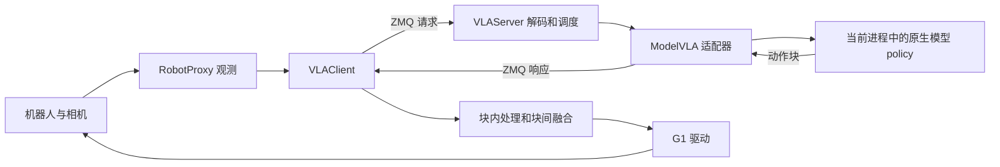

# Open-RAIL 脚本精简与模型适配工程化分析

分析日期：2026-10-12。对象：`/home/bjtc/Sophix/g1-open-rail` 当前工作树，HEAD 为 `00457be`，包含尚未提交的 ECOT 接入改动。

## 核心结论

你的方向是对的：**机器人执行侧应该只依赖明确的推理服务契约，切换模型主要切换部署配置，不应每增加一个模型就增加一套客户端和服务端 sh 文件。** 但当前 Open-RAIL 整体还包含模型加载服务；它既负责调用推理，又提供把模型包装成服务的能力。因此，“Open-RAIL 只是调用模型服务”对客户端成立，对整个仓库还不完全成立。

建议先做三件事：统一启动入口、将完整配置改成基础配置加差异配置、把模型加载差异封装在小型 backend 中。保留已经工作的 ZMQ 链路，先消除复制，再按需要增加对原生 WebSocket 服务的连接能力。无需为了减少几个脚本立即重写通信和机器人控制。

最直接的精简收益已经有源码证据：

- `scripts` 中有 10 个 shell 脚本，其中 4 个是 LingBot 和 ECOT 各一套 server/client 启动器；这 4 个应由固定入口和 deployment profile 取代。
- 两份模型客户端 YAML 各 615 行，递归比较只有 **4 个叶子字段**不同；大量其他机器人、回零姿态和记录参数被重复保存。
- LingBot 和 ECOT 的观测映射及动作封装基本相同；差异集中在 checkpoint 校验、加载实现、进程环境和任务文本。
- 原版 `ORI-lingbot-vla` 有实际 API 和路径差异，现有适配器不能只修改 `repo_path` 就直接复用。

本文的 `lingbo`、`lingboecot`、`lingbo-ori` 分别按本机 `lingbot-vla`、`worktrees/branch-ecot`、`ORI-lingbot-vla` 理解。第三者以本机代码为准，不将目录名称视为未经修改的官方发布版本。以下方案是待实现的架构设计；本次只分析并新增报告，没有启动模型、连接机器人或更改业务代码。

## 当前调用边界



现有服务不是“ZMQ 收到请求后再访问 LingBot WebSocket”。实际是 `run_server.py` 根据 `ModelType` 导入适配器，适配器再导入相邻模型仓库的 Python 类，把权重加载到这个服务进程中。[服务入口](../run_server.py)、[服务调度](../server/core/vla_server.py)、[LingBot 适配器](../server/models/lingbot_vla/lingbot_vla.py)

这已经实现了机器人 SDK 环境与模型进程分离。问题在于模型加载、部署环境、注册表和参数处理仍然与 Open-RAIL 服务端耦合。新增模型时要改 `ModelType`、配置工厂、`get_model`、CLI choices、参数覆盖分支；随后又容易复制启动脚本、客户端 YAML 和 README。[模型配置](../conf/models_conf.py)

真正应该保持稳定的边界是：**观测进入模型服务，模型服务输出具有明确物理含义和时间含义的动作块，执行端负责调度、轨迹衔接和设备控制。** 同样是 `50×16` 数组，关节顺序、绝对或相对动作、夹爪方向、训练采样频率只要一个不同，就不能直接执行。

## scripts 逐项处理建议

下表覆盖目录内全部程序入口；README 和示例图片随对应工具归档。优先级 P0 表示直接减少重复，P1 表示边界整理，P2 表示后续维护。

| 当前脚本 | 实际职责 | 建议 | 优先级 |
|---|---|---|---|
| `run_lingbot_server.sh` | 选择解释器、源码、tokenizer，启动统一 server | 与 ECOT 入口合并；差异写入模型部署配置 | P0 |
| `run_lingbot_ecot_server.sh` | 同上，额外约束源码导入和环境变量 | 保留隔离语义，迁入通用 launcher，不能合并时丢掉 `PYTHONNOUSERSITE` 等约束 | P0 |
| `run_lingbot_g1_client.sh` | source GDK，选择客户端配置 | 改成模型无关的 G1 client 入口，参数选择 deployment | P0 |
| `run_lingbot_ecot_g1_client.sh` | 同上，加 Web 地址和端口默认值 | 合并；Web 地址和端口属于部署配置 | P0 |
| `setup_g1_env.sh` | 创建 Python 3.10 环境，安装 GDK wheels 和约束依赖 | 保留为安装工具，移至 `scripts/setup/`；不是模型启动步骤 | P1 |
| `g1_pc_gdk_env.sh` | 激活客户端环境、source 厂商环境、设置路由和 Aorta | 保留一个共享环境引导；机器人 IP、SDK 路径移到 machine 配置 | P1 |
| `ros_env_wrapper.sh` | 启停厂商 forwarder，设置动态库与 ROS 环境 | 保留设备桥接职责，可放 `scripts/robot/`；移动前核对厂商或外部调用路径并提供兼容入口 | P1 |
| `g1_enter_copilot.sh` | 检查远端服务、idle→COPILOT、验证组件和 HAL | 保留独立机器人运维命令；已有 dry run 和显式执行边界不应因精简而消失 | P1 |
| `run_a2d_sdk.zsh` | 依赖当前目录的旧 `a2d_sdk/env.zsh` 和旧服务命令 | 标记 legacy；验证无外部使用后移除，改用已维护的 G1 流程 | P0 |
| `clear_log.zsh` | 按当前目录和 Python 3.10 文件名删除日志 | 从正常启动流程移除；改为显式日志目录、保留期限和预览参数的维护命令 | P2 |
| `clean_cuda.py` | 打印 CUDA 信息并清理当前新进程的 allocator 缓存 | 删除“释放其他模型进程显存”的用途预期；如保留则改为 GPU 诊断工具 | P0 |
| `analyze_joint_trace.py` | 分析动作、命令、反馈及运动起点 | 保留，归入 `tools/diagnostics/`，这是跨模型的执行诊断能力 | P1 |
| `show_lerobot_data/show_data.py` | Matplotlib 数据查看器 | 与 Qt 版共享数据读取和字段映射，保留一个默认前端 | P2 |
| `show_lerobot_data/show_data_qt.py` | Qt 数据查看器 | 作为可选 GUI；默认个人数据路径改为显式参数 | P2 |
| `vla_eval/vis_eval.py` | 离线推理评估和可视化 | 改用统一 backend 或推理服务，移到 `tools/evaluation/`，不再每个模型手改源码 | P1 |

`clean_cuda.py` 在自己刚启动的进程中调用 `gc.collect()` 和 `torch.cuda.empty_cache()`，不能释放另一个模型进程持有的权重。这一入口名称容易造成误解。[代码](../scripts/clean_cuda.py)

`vla_eval/vis_eval.py` 明确写着换模型要修改 TODO，并硬编码导入 `gr00t_n1_5`，同时夹带相机字段、夹爪归一化和数据布局假设。这是第二条重复的模型适配路径，必须与在线服务共用适配定义，否则启动脚本减少了，评估脚本仍会持续分叉。[代码](../scripts/vla_eval/vis_eval.py)

通用 server/client 可以直接利用已有 `open-rail-server`、`open-rail-web-client` console entry point 演进，无需再造三组同义命令。最终公开日常入口固定为 server、client、doctor；安装和机器人运维仍保留独立入口。[打包配置](../pyproject.toml)

## 目录复杂度还来自哪里

### 配置保存了整个系统而不是当前部署

当前两份 YAML 不仅保存 G1，还包含 mock、navi_wa2、ti5_t170c 的配置。两个文件的实际差异如下：

| 字段 | LingBot 当前值 | ECOT 当前值 |
|---|---|---|
| `language.file_path` | `lingbot_package_language.json` | `lingbot_ecot_package_language.json` |
| `controller.speed` | 1.0 | 0.8 |
| `controller.wait_time` | 10 ms | 100 ms |
| `record.save_dir` | `data/lingbot_package` | `data/lingbot_ecot_package` |

ECOT README 写的是启动初始值 `speed=0.5`、`wait_time=300 ms`，与当前 YAML 已不同。运行与复现应以解析后的配置快照为准，不能依赖 README 的历史参数。[LingBot 配置](../conf/lingbot_package.yaml)、[ECOT 配置](../conf/lingbot_ecot_package.yaml)、[ECOT 说明](../README-LingBot-ECOT-G1.md)

Web 端 `_apply_yaml_config` 已支持把字段覆盖到默认配置，因而第一阶段就能缩短手写 YAML。但其保存函数会导出整个配置，启动时应用失败也可能只记 warning；只手动删几百行会被下一次保存重新展开。需要同时区分“编辑差异配置”和“导出运行快照”，并让显式指定且无效的部署配置启动失败。[配置加载与保存](../web_client/server.py)

### 运行核心与工具缺少清晰入口

Web 服务文件约 2098 行，VLAClient 约 1106 行；记录、轨迹、语言、可视化等模块提供的多数功能有明确用途。应该按职责拆分 Web 路由和可选组件初始化，而不是因为文件多就删除轨迹衔接、观测同步、暂停复位等核心能力。

`test/` 与 `tests/` 并存，适配器测试分散；后续统一测试入口，保留对旧路径的短期兼容。`report/`、论文、历史记录、`site/`、备份文档不是运行关键路径，先整理导航和归档，不作为首轮高风险删除项。对其他机器人和模型采用显式选择、按需加载，避免当前 G1 配置承担所有默认值。

## 三种 LingBot 的真实差异

| 适配内容 | LingBot | LingBot ECOT | 本机 ORI LingBot |
|---|---|---|---|
| Open-RAIL 现有 backend | `lingbot_vla` | `lingbot_ecot` | 无独立注册 |
| 源码 | `../lingbot-vla` | `../worktrees/branch-ecot` | `../ORI-lingbot-vla` |
| 原生类 | 50 步主类；25 步专用类 | 当前适配器固定主类 50 步 | 主类；本机 deploy 目录无 chunk25 专用类 |
| 构造 API | 支持 `rtc_mode` | 支持 `rtc_mode` | 不支持 `rtc_mode` |
| 机器人配置路径 | 相对模型源码解析 | 相对模型源码解析并检查归属 | `configs/robot_configs/...` 相对进程 cwd |
| checkpoint 校验 | package_a2d、horizon、arm stats | 加上 LoRA、辅助 heads、stats 和源码归属 | 需补适配层校验并核对原生 loader 兼容性 |
| 观测映射 | 三相机、16 维状态、task | 当前与 LingBot 相同 | 本机 package_a2d 布局可共享映射，仍需推理验收 |
| 对外输出 | 25×16 或 50×16 绝对目标 | 当前固定 50×16 绝对目标，`ext={}` | 由 checkpoint horizon 和 `use_length` 决定，不能按名称猜 |
| 任务文本 | 无条件翻转表述 | 根据标签朝向决定是否翻转 | 应与具体训练任务匹配 |

### 可以直接共享的部分

两个现有适配器的输入都是长度为 1 的观测序列。读取 `state[:16]`，映射 `cam.head`、`cam.hand_left`、`cam.hand_right` 到原生模型相机键，把单元素 `language` 转为 `task`。输入图像要求 HWC、RGB、uint8；复制图像和状态，避免原生预处理修改调用者输入。

输出转换成 float32，检查 horizon、16 维和有限值，封装 `type=vla_action`、`pred_action`、两种时间戳及 `ext`。这些适合抽为 `PackageA2DCodec` 或小型纯函数库。[LingBot infer](../server/models/lingbot_vla/lingbot_vla.py)、[ECOT infer](../server/models/lingbot_ecot/lingbot_ecot.py)

不要把“共享协议代码”误解为“共享可变配置”。两个模型的部署文件、运行目录、任务选择和进程状态仍应独立；公共基础配置只读，解析时深复制，Web 保存不能改写另一个 deployment 使用的基础文件。

### LingBot 的特殊兼容性

当前适配器按 25 和 50 选择不同原生类，并处理训练 horizon=25、旧 `config.json` horizon=50 的已知特殊情况。这不是任意截取 50 步动作就能得到一个正确的 25 步模型：FeatureTransform 和按时间步统计的归一化也与训练 horizon 绑定。

因此将“兼容某个旧 checkpoint 的修正”留在明确的 loader 版本中，声明适用条件，不能升级成所有模型默认容错。

### ECOT 的特殊兼容性

当前 ECOT 校验器要求 package_a2d、50 步、LoRA、三种辅助 head，并检查 safetensors 权重头与统计量。应保留这些检查，但以版本化的 `artifact_validator` 表达，而不是给通用 launcher 写 ECOT 分支。[校验器](../server/models/lingbot_ecot/lingbot_ecot.py)

必须区分两层含义：现有 Open-RAIL 适配器**不向执行端输出 ECOT 辅助预测**；这不等于 ECOT 辅助预测永远不会影响模型内部动作生成。本机 branch-ecot 的 `sample_actions` 已根据 `ecot_action_conditioning` 可选地调用 `ecot_condition`，并有 visibility 相关能力。[模型源码](../../worktrees/branch-ecot/lingbotvla/models/vla/pi0/modeling_lingbot_vla.py)

因此将来的 ECOT checkpoint 不能仅用 `model_type=lingbot_ecot` 描述全部行为。profile 应记录辅助监督、动作条件化、visibility、head schema、源码版本和 loader 版本。当前校验器的三个 head 条件不代表它覆盖所有未来 ECOT 变体。若只展示 bbox、阶段或标签，可通过有版本的 `ext.ecot` 输出；是否用于任务切换应由独立任务策略决定，不能直接把分类分数当成通用任务完成率。

### ORI LingBot 需要真正补适配

直接把现有脚本的 `LINGBOT_REPO_PATH` 指向 ORI 目录至少有两个确定性问题：

1. 现有适配器总会传 `rtc_mode='off'`，ORI 构造函数没有这个参数，会发生不支持关键字参数的错误。
2. 即使去掉该参数，ORI `reset('package_a2d')` 相对 cwd 查找 `configs/robot_configs/package_a2d.yaml`；当前脚本在 Open-RAIL 根目录启动，路径不对应 ORI 仓库。

实现一个小型 `LingbotOriLoader`：明确构造参数、规定 cwd 或修复原生路径解析、验证 checkpoint、stats 和机器人布局，再共享 package_a2d 编解码。不要通过捕获任意 `TypeError` 后删除参数重试来推测版本，那可能掩盖模型内部真正的错误。[ORI 部署实现](../../ORI-lingbot-vla/deploy/lingbot_vla_policy.py)

ORI 原生 loader 与当前 fork 的加载路径也并不完全相同，不能推断任意 LoRA 权重都可交叉加载。没有指定 ORI checkpoint 时，可以确认适配工作清单，不能承诺其 horizon、归一化和实际推理兼容性。

## 模型适配应该拆成哪些工作

| 工作 | 所属层 | 新 checkpoint 是否通常需要代码 |
|---|---|---|
| 指定源码、解释器、工作目录、环境变量 | 部署 profile 和 launcher | 否 |
| 指定权重、stats、tokenizer、训练配置 | 模型 artifact profile | 否，但必须校验 |
| 实例化模型、恢复 LoRA 或特殊网络结构 | backend loader | 同一种加载 API 通常不需要 |
| 相机键、状态布局、历史帧、任务文本输入 | 模型输入 codec | 相同接口通常不需要 |
| 模型专用 resize、归一化、反归一化 | 原生 policy 或模型 codec，单一责任方 | 新语义可能需要 |
| 动作关节序、单位、绝对或相对转换 | 服务边界 action codec | 新动作语义需要 |
| ZMQ 或 WebSocket 打包与连接 | transport provider | 同协议不需要 |
| 任务 prompt、动作速度、记录目录 | task、execution 和 deployment profile | 否 |
| Robot SDK、夹爪驱动、相机同步 | robot backend | 换模型不应修改，除非能力要求改变 |
| golden observation 和契约验收 | 共用验证工具加测试数据 | 每个部署实例需要结果，不需复制 runner |

原则是：**只有模型语义或加载 API 的新差异才增加代码；名称、路径、超参数和启动方式的差异只增加配置。** Python loader 的数量可以增长，日常 shell 入口的数量应保持固定。

## 推荐目标架构

### 先保留现有 ZMQ 服务

第一阶段使用 `BackendRegistry + ModelBackend + ProfileResolver + Launcher` 四个明确组件，不引入复杂工作流平台。

- `BackendRegistry`：模型类型到 loader、validator、codec 的映射；统一 CLI 从注册表或 profile 解析，移除多处模型枚举分支。
- `ModelBackend`：负责模型生命周期和推理，定义 `describe()`、`validate_artifacts()`、`load()`、`infer()`、`reset_session()`、`close()`。
- `ProfileResolver`：生成类型明确、路径已解析的配置，检查未知字段和不兼容能力，保存有效配置及来源。
- `Launcher`：选择解释器、cwd 和环境，启动独立进程；不包含任何 checkpoint 或机器人动作逻辑。

初期用一个静态 Python 注册表即可；确实需要跨仓库发行 backend 时，再加入 package entry points。无需一开始设计下载插件和动态发现框架。

模型进程必须隔离。三个源码 checkout 使用同名 `deploy`、`lingbotvla` 包，改变 `sys.path` 不能替换已在 `sys.modules` 中的模块。当前 ECOT 的导入归属检查应保留；同一服务进程不热切换不同 checkout。共享 Python 解释器不等于依赖隔离，依赖发生分歧时用独立 venv 或镜像。

### 原生远程推理是可选 provider

第二阶段确有需要时增加 `RemotePolicyBackend`，连接模型仓库原生 WebSocket 服务。可先放在现有 ZMQ 服务后，减少客户端改动：

```text
G1 client → 现有 ZMQ → 通用 gateway → WebSocket 模型服务
                         └─ 统一契约校验、时间戳和错误转换
```

这条路径会增加一跳和序列化开销，需要测量端到端延迟。长期如果多种远程服务都值得直接连接，再在客户端抽象 `PolicyClient`，支持 ZMQ 和 WebSocket transport。二者共用观测/动作契约，不能各自再写一套模型 mapping。

原生 LingBot WebSocket 使用 msgpack numpy，连接后的首条消息是 metadata；推理返回 `action` 和可选 `server_timing`。Open-RAIL 当前使用 ZMQ multipart、pickle 数据和 JSON meta，返回 `pred_action` 及时间戳。**端口不是协议转换器，不能把 WebSocket 地址填进现有 ZMQ 配置就认为完成适配。** [原生服务](../../ORI-lingbot-vla/deploy/websocket_policy_server.py)、[Open-RAIL ZMQ](../server/core/zmq_server.py)

远程 provider 还需实现初始 metadata 消费、reset 握手、二进制数组映射、超时重连和结构化错误。对于原生服务没有 request id 的情形，至少串行维护一条连接；一次请求超时后关闭并重建连接，不能把迟到结果当成下一次请求的返回值。

## 推理服务契约不能只定义数组形状

建议先将现有协议命名为兼容版本，再增量增加 capabilities 和结构化校验。无需立刻迁移全部第三方模型。

| 契约部分 | 至少需要表达的内容 |
|---|---|
| 身份 | protocol version、backend version、模型源码 revision、checkpoint 和 norm 标识 |
| 观测 | 相机名称、RGB/HWC/uint8、图像尺寸规则、状态维度/单位/顺序、任务文本、历史帧数 |
| 动作 | horizon、action layout、单位、absolute/delta、夹爪方向和范围、数据 dtype |
| 时间 | 模型动作采样周期、参考观测 id、设备时间戳及单位、客户端请求关联时间 |
| 能力 | 是否支持 history、reset、RTC、ECOT 输出、并发和多 session |
| 生命周期 | describe、health、infer、reset_session、close；错误码与 ready 状态 |
| 关联 | request_id、session_id、episode/generation id，响应必须原样关联 |

对于当前 G1 package_a2d，可定义一份具名 contract：状态进入模型前取左臂 7、右臂 7、左右夹爪共 16 维；输出为相同顺序的 16 维绝对目标，手臂角度为 rad，夹爪为约定方向的归一化控制值。20 维机器人观测中的头、腰不自动变成模型控制目标；其他 embodiment 应使用自己的 layout，不能把 16 维写死进所有模型服务。

### 归一化和动作转换只能发生一次

本机 package_a2d 训练配置规定手臂目标相对当前观测状态，夹爪目标不减状态；原生 `FeatureTransform.unapply()` 已恢复绝对手臂目标。现有适配器正确地直接返回，不再加一次 state。统一接口后要继续确保这一点，并明确 delta 究竟相对当前观测还是前一动作。[机器人特征配置](../../ORI-lingbot-vla/configs/robot_configs/package_a2d.yaml)

图像亦然：当前客户端配置为 `vision.preprocess.method=none`，服务端默认不 pad/resize，原生模型自己处理输入。未来不能在客户端、gateway、原生模型三处都按各自默认值缩放。

### 训练频率与执行频率不同

当前 `VLAClient` 用 `1 / (speed × raw_fps)` 构造动作采样间隔，控制周期另由 `controller.period` 决定；模型响应没有提供采样周期。新模型即使输出维度一致，只要训练频率不同，沿用 `raw_fps=30` 就会改变动作的时间含义。[客户端时间轴](../client/core/vla_client.py)

应让服务描述原始 `action_dt_s`，execution profile 决定速度倍率，控制器决定实际命令周期。兼容期先把 `raw_fps` 与服务 metadata 做一致性校验。25/50 是预测长度，不等于全部动作必然执行完。

### 异步和 RTC 不能混为一谈

现有两个适配器都传 `rtc_mode='off'`。Open-RAIL 客户端异步执行旧轨迹、获取新轨迹，并做块间融合；模型内部 RTC 则可能需要剩余动作、推理延迟和特定动作空间的 guidance。

若以后启用 RTC，需要定义剩余动作在哪个空间表示、时间如何对齐、何时 reset，以及它与执行侧平滑如何组合。不能只在新 profile 写 `rtc=true` 就宣称兼容。

### 生命周期需要端到端成立

当前客户端已有 request id 匹配和迟到响应丢弃，RealtimeDataManager 也有本地 action generation 机制；这些应保留。[请求关联](../client/core/vla_client.py)、[动作代际](../client/core/realtime_data_manager.py)

但适配器只在初始化调用原生 policy reset，服务协议没有显式分发模型 session reset。对有历史或 RTC 状态的模型，清空客户端轨迹不等于清空模型状态。新增 reset 应携带 session/generation，等待服务确认后才接受新 episode 的动作；旧 generation 的结果一律丢弃。

当前 heartbeat 含模型名和路径，但不足以校验完整 action contract；异常主要打印，客户端可能只能看到超时。应增加 loading/ready/failed 状态和带 request id 的错误响应；单 worker 保留为有状态模型的默认值，并明确单 session 或队列策略。

`loc_timestamp` 来自客户端 `perf_counter()`，应原样回传以便客户端计算往返时间。服务端直接减另一台机器的 monotonic 值不能可靠表示通信延迟；跨机部署应分别记录服务端处理耗时与客户端往返耗时，不能依赖两个主机的 monotonic 原点一致。

## 配置和启动方式设计

### 推荐配置目录

```text
conf/
  robots/agibot_g1.yaml
  contracts/package_a2d_v1.yaml
  tasks/package_flip.yaml
  tasks/package_conditional.yaml
  execution/package_baseline.yaml
  models/lingbot.yaml
  models/lingbot_ecot.yaml
  models/lingbot_ori.yaml
  deployments/g1_lingbot.yaml
  deployments/g1_ecot.yaml
  deployments/g1_ori.yaml
  machines/local.example.yaml
runtime/<run_id>/
  resolved_config.yaml
  manifest.json
  logs/
```

machine 文件保存解释器、SDK、checkout、tokenizer 和设备地址等机器路径；model 文件保存 loader 和 artifact 绑定；task 文件保存 prompt；execution 保存速度和融合参数；deployment 负责组合。机器私有配置不提交，提供模板。

基础值→具名配置→部署覆盖→机器路径绑定→显式 CLI 覆盖，顺序必须固定。列表默认整体替换、未知键报错、不允许机器层偷偷覆盖动作契约。相对路径以所属配置文件或明确配置根目录解析，不能跟随调用 shell 的 cwd 漂移。避免无限 include，起步使用显式命名引用即可。

### 配置示意

以下是拟议 schema，不是当前程序已经支持的格式；其中路径占位值需要替换。

```yaml
schema_version: 1
id: g1_ecot
robot: agibot_g1
contract: package_a2d_v1
task: package_conditional
execution: package_baseline
model:
  backend: lingbot_ecot
  validator: ecot_package50_lora_v1
  runtime: ecot_runtime
  artifacts:
    checkpoint: /path/to/hf_ckpt
    normalization: /path/to/norm_stats.json
  parameters:
    chunk_size: 50
    num_denoising_step: 10
    rtc_mode: "off"
endpoint:
  transport: openrail_zmq_v1
  host: 127.0.0.1
  port: 5566
client:
  web_host: 127.0.0.1
  web_port: 9001
  overrides:
    controller:
      speed: 0.8
      wait_time: 100
    record:
      save_dir: data/lingbot_ecot_package
```

解析器需验证字符串枚举；`off` 使用引号，避免 YAML loader 将其解释为布尔值。读取 checkpoint 时核对 profile 声明，不能仅相信用户填入的 `chunk_size`。

建议用户最终只记住这些命令，参数仍属待实现：

```bash
open-rail-server --deployment conf/deployments/g1_ecot.yaml
open-rail-web-client --deployment conf/deployments/g1_ecot.yaml
open-rail-doctor --deployment conf/deployments/g1_ecot.yaml --check artifacts
open-rail-doctor --deployment conf/deployments/g1_ecot.yaml --check inference --observation /path/to/sample
```

换 ORI 只换 deployment 路径。新增一个兼容 checkpoint 只增加或修改 artifact profile，不新增 sh。若团队偏好统一 `open-rail server/client/doctor`，可以之后提供一个总入口，但不要同时长期维护两套完整用户命令体系。

### 通用 launcher 必须解决的细节

客户端需要厂商 shell 环境，所以“全部变 Python”不必作为目标。保留一个很薄的 Bash bootstrap，source GDK 后 exec 通用客户端即可；没有模型名称分支。

模型启动器读取 runtime 配置后，用参数数组启动所选 Python，显式指定 cwd、环境变量和绝对入口路径。避免拼接 shell 命令字符串和 eval。服务 worker 使用内部模式，防止 launcher 重复自启动；进程退出与信号应能传到真正模型进程。

ORI 可暂时通过 runtime cwd 指向 ORI 仓库解决相对 robot config；更稳妥的是在原生实现或兼容 loader 内固定源码相对路径。不要在多线程服务运行中临时 `os.chdir()`。

统一参数优先级也很重要：现有 LingBot server 把用户参数放在末尾，ECOT server 把固定模型参数放在末尾；同一重复参数的覆盖行为并不一致。统一入口应拒绝 deployment 身份被通用参数偷偷覆盖；允许覆盖的字段通过明确白名单和最终配置打印表达。

## 不能随着脚本一起合并掉的行为

G1 当前驱动包含任务历史行为：左夹爪保持进入控制时的开度，右夹爪使用非线性曲线；模型的第 14 维左夹爪输出没有按普通双夹爪策略执行。即使新模型服务完全符合 16 维接口，双手抓取任务也可能不适用。[G1 控制实现](../client/robots/agibot_g1/body_robot.py)

应把这一行为显式命名为 execution/robot policy，并提供可验证的兼容性约束。模型切换时检查所需夹爪能力；不能默认所有 G1 模型都接受“左爪锁住”。夹爪状态归一化、设备标定和执行策略要区分责任，避免复制到每个模型适配器。

机器人运维和模型服务管理应保持边界。启动模型不自动切换 COPILOT，启动 Web 不自动启用 Control；两个部署即使 Web 使用 9000/9001，仍可能共用 ZMQ 5566、可视化 8765 和同一机器人。多实例必须统一分配所有端口和控制所有权，不能仅凭 Web 端口不同判断可并行控制。

## 分阶段实施与验收

| 阶段 | 具体修改 | 完成标准 |
|---|---|---|
| P0 固化基线 | 记录当前有效配置、源码 revision、checkpoint/stats 标识、prompt、解释器和测试入口 | 新旧行为可对照；README 参数不再充当运行事实来源 |
| P1 统一启动与配置 | 给现有两个入口增加 deployment 参数；实现 resolver/launcher；4 个模型 sh 变兼容转发器 | LingBot、ECOT 使用同一入口；新增 ORI 不增加 sh；显式坏配置拒绝启动 |
| P2 共用适配骨架 | 注册表、package codec、独立 validator/loader；补 ORI loader | 新模型不再修改多处 CLI 分支；输入映射和输出检查只维护一份 |
| P3 补齐服务契约 | describe/ready/error、时间与能力校验、session reset | 错误模型、动作布局、频率和迟到响应能在控制前被识别 |
| P4 统一工具与目录 | 离线评估复用 backend；分析工具归档；测试目录统一；旧入口弃用 | 在线/离线同一适配定义，文档只有一份接入流程 |
| P5 按需远程化 | 增加 WebSocket provider 或直接 PolicyClient transport | 与原生服务输出一致，重连/reset 可验证，额外延迟有实测 |

P1 可以先保持两个现有适配器完全不变，优先得到最直观收益。P2 再提取共用函数，保留现有校验和错误行为；不要同时重构 G1 驱动、融合算法和传输协议，以免失去归因能力。

### 每个模型部署的验收清单

1. **静态 artifact 验证**：训练配置、horizon、stats 形状及有限值、权重结构、源码归属、解释器、robot layout 一致。失败不进入 ready。
2. **离线契约验证**：用固定观测检查键映射、颜色、状态顺序、语言、输入不被修改、输出形状和有限性；覆盖缺相机、错误 horizon、非法输出。
3. **原生对照**：同一 checkpoint、观测和随机状态，对比 native policy 与 adapter；归一化与绝对动作恢复必须一致。随机生成模型使用确定性条件或明确误差容限，不能要求无条件逐位相等。
4. **协议生命周期验证**：超时、重连、重复/迟到响应、reset 前后、单 session 限制、进程加载失败。远程 provider 特别验证首条 metadata 和 reset 响应不会被当成动作。
5. **闭环前诊断**：观测及只推理模式测量延迟分布、有效动作覆盖时间、队列积压和停止恢复行为；模型推理正确不等于整条执行链正确。
6. **受控执行验收**：核对动作语义及夹爪策略后，通过 joint trace 对比模型目标、实际命令和反馈，再判断速度和融合参数。

已有 `test/test_lingbot_vla_adapter.py`、`tests/test_lingbot_ecot_adapter.py` 覆盖映射、输入所有权、归一化、非法输出、源码碰撞以及可选真实观测对照，可以扩展为共用契约测试。[LingBot 测试](../test/test_lingbot_vla_adapter.py)、[ECOT 测试](../tests/test_lingbot_ecot_adapter.py)

真实 GPU 测试目前通过环境变量显式开启，未设置时会 skip。重构验收必须区分“替身 policy 的接口测试通过”和“真实权重推理通过”，不能用前者代替后者。本次报告未运行这些测试，也未据历史 README 推断当前 GPU 或真机状态。

## 新模型接入最终应当是什么体验

对于相同 API 和动作契约的 LingBot 新 checkpoint，维护者只绑定权重、stats、任务和 runtime，执行 doctor 与原生对照，然后使用既有 server/client 命令。无需新增启动脚本、修改机器人驱动或复制客户端配置。

对于 ORI 这种 API 不同但观测和动作契约相近的实现，新增一个小 loader 和一份 profile，共用 codec 和验证流程。

对于真正不同的新模型，新增 backend、必要 codec、能力描述和测试样本。如果模型服务已经实现统一契约，则只需配置 endpoint；模型源码和依赖由该服务自身负责。

衡量工程化成果的标准是：**新增模型只增加它真正不同的部分，并能自动验证这种差异；日常启动命令、机器人执行链和测试 runner 不随模型数量增长。**
