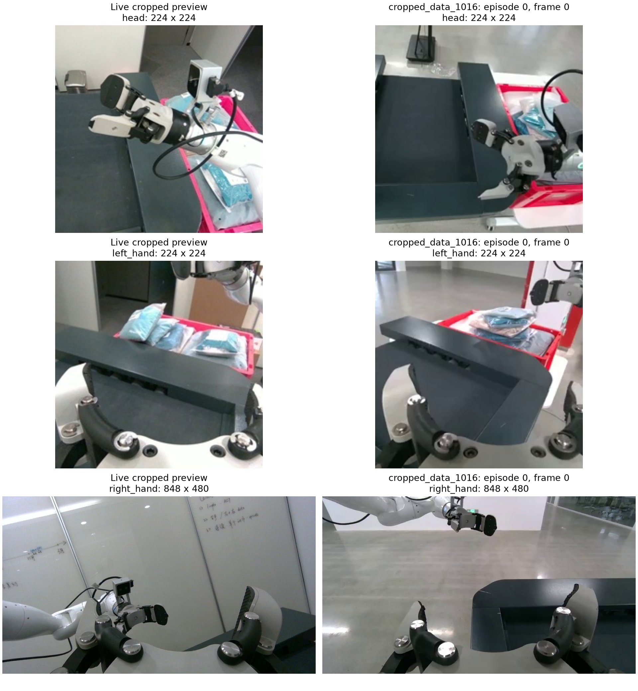

# 实机图像与 cropped 样本、1015 norm 核查

日期：2026-10-18。未修改配置、未发送机器人动作。

## 更正：训练实际使用的 norm（用户确认）

用户确认该次训练使用 `/home/bjtc/Sophix/ORI-lingbot-vla/trained-model/10-18-cut0922/norm.json`。因此此前部署指定的 `10-18-only1015/norm.json` **与训练不一致，应更换部署参数**。下文对本机 1015 统计的数值验证仍成立，但不代表这份文件适合该 checkpoint；不能用数据集名称推断应选的 norm。

已检查训练用文件：结构/维度及 checkpoint 元数据检查通过，SHA256 为 `f5b6d6bfc4aae85dc7c709536b3daff6a8ee36300b4d657467df7826aeedeba9`，count=635213。原部署文件 count=276886，两份统计确实不同。

差异包括：手臂 state 均值最大相差约 0.728 rad；右臂第 7 关节 state 标准差为训练文件 0.28038、原部署文件 0.86189；第 49 步该关节 action 增量标准差为训练文件 0.16192、原部署文件 0.39107。错误文件会同时改变 state 归一化和 action 反归一化，是已确认的部署配置不匹配，但不能未经复测断言它是机器人动作小的唯一原因。

应停止 Control，使用训练时的 `10-18-cut0922/norm.json` 重启模型服务，清除/重建客户端旧动作缓存后再测试。本次未切换运行中的服务或发送机器人命令。

## 图像比较



左列是本次从网页 WebSocket 读取的机器人裁剪预览；右列是 `cropped_data_1016/train` 的 episode 0 首帧。两组图不是同一时刻或同一姿态；网页预览复用服务端 ROI/缩放逻辑，但额外经历 JPEG 编码，不能视为模型输入的逐像素转储。

- 尺寸匹配：头部、左腕 224×224；右腕 848×480，未裁剪。
- 头部：实时画面中夹爪和手臂在图像上半部形成明显遮挡，cropped 示例夹爪主要位于右下；传送带、箱体与物体在画面中的位置不同。
- 左腕：都能看到传送带、包裹与红箱，但观察方向、透视与物体位置明显不同。
- 右腕：实时画面主要看墙面、白板与另一只夹爪；示例主要看地面、工作台及另一只夹爪。视野差异大，可能与当前腕部姿态有关；单帧不能确定安装角度是否变化。
- 没有从这些画面发现明显的红蓝通道互换，但不同场景无法用像素差值评价裁剪是否正确。

特别注意：`datasets/crop_1016_repro/README.md` 的复现命令以 `marked_9_1_0922` 为输入。当前模型训练配置指向远端 `1015spilt_gop30_lossless/train`。因此右列只能作为现有 cropped 数据的示例，不能证明它就是 only1015 模型的训练视野。需从该模型实际训练目录取帧才能完成最终核对。

## norm 文件核查

当前文件：`/home/bjtc/Sophix/ORI-lingbot-vla/trained-model/10-18-only1015/norm.json`。

它与本机 `/home/bjtc/Sophix/datasets/datav2_1015_split/train_stats/norm_stats.json` 的 SHA256 完全相同：

```text
438eba41036bc97fd1a688ff12259b471358bfc96ec600cd18b2583c0cab3dfa
```

重新读取本机训练集全部 276886 帧，计算以下均值、标准差、最小值和最大值，与 norm 逐项对比，最大差均为 0：

- 14 维手臂 state。
- 2 维夹爪 state。
- 2 维夹爪 action。
- 手臂 `action - 当前 state`（50 步统计中的第 0 步）。

本次没有重算全部 50 个未来步的统计；文件形状检查为 `(50,14)`，分位数上下界顺序正常。详细结果见 `norm_check.json`。

## 对“不动”的解释线索

- 左臂动作增量标准差约 0.00005～0.00013 rad，训练数据中当步 action 与 state 的最大差也只有约 0.00133 rad（0.076°）。这与训练任务中左臂基本保持不动一致，不能单凭左臂不动判断 norm 损坏。
- 左夹爪 action 的均值、标准差、最小和最大值全部为 0。原生归一化/反归一化使用 `std + 1e-6`，不会因为这个零方差直接除零；而客户端自动控制也会保持左夹爪位置。
- 右夹爪 state 为原始反馈量，范围 0～120；右夹爪 action 为 0～1。两者不同是数据及 SDK 接口约定，不能把 state 和 action 使用同一套数值范围。
- 右臂动作增量标准差：第 0 步约 0.010～0.027 rad，第 49 步约 0.137～0.391 rad；norm 并没有把右臂所有输出尺度压到零。
- 恢复的 0922 默认左臂有部分关节超出该 1015 state 统计范围，例如左臂第 3 关节默认约 0.273，而训练最小约 0.319；第 4 关节默认约 -1.205，而训练最小约 -1.100。这提示位姿/视野匹配需要核对，不能由此单独确定不动根因。

结论：当前 norm 对本机 1015 数据的统计与动作定义是合理且可复核的。是否与远端训练实际使用的 `norm_stats_1015.json` 完全一致，仍需拿远端文件或其校验和确认；本机一致性不能替代训练来源核对。
