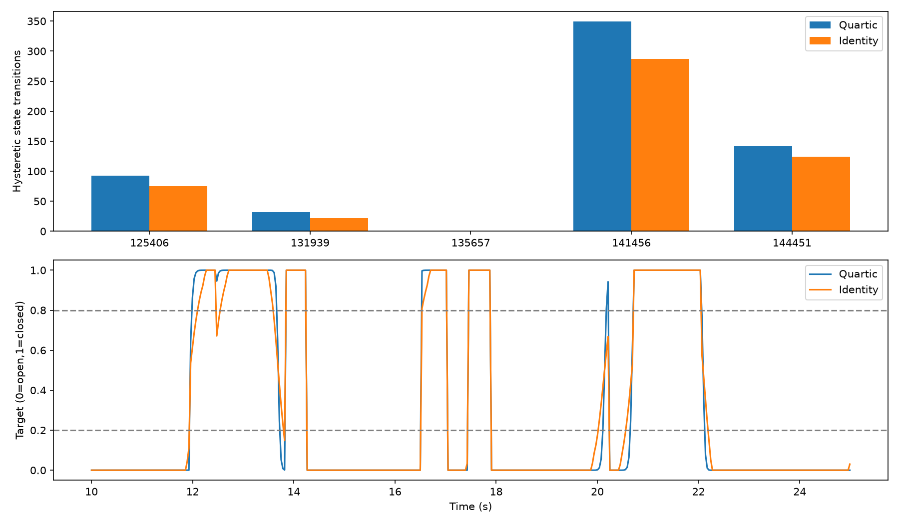

# 去掉四次方映射的离线对照

本次将“4条插值”理解为四次方映射 `q=x^4/(x^4+(1-x)^4)`。只去掉此映射，保留原有 9 点滤波、阈值吸附、相邻平均、偏移、执行索引和实际日志时序。读取五组已有指令 CSV，共 53655 条；逐条检查四次方映射与日志吻合，误差 <1e-12。未修改部署或控制机器人。

## 结论

按目标 ≥0.8 记作闭合、≤0.2 记作打开、中间为中间位置：975 条原闭合目标会变成中间位置，占原闭合目标 6.99%；开合状态切换由 616 减至 508，下降 17.53%。这说明振幅和阈值切换会减少，同时闭合意图也会减弱。不能认为这些切换减少等于抓取恢复正常。

## 闭合目标损失

| 判断闭合的阈值 | 使用四次方的闭合采样数 | 去掉后的闭合采样数 | 不再达到阈值 |
|---|---:|---:|---:|
| ≥0.8 | 13952 | 12977 | 975 |
| ≥0.9 | 13769 | 12394 | 1375 |
| ≥0.95 | 13566 | 12115 | 1451 |
| ≥0.99 | 13199 | 11792 | 1407 |
| 严格等于 1 | 11792 | 11792 | 0 |

975 条对应约 0.586≤x<0.8，因此它们变成中间目标，不会直接变成 ≤0.2 的打开目标。若以 ≥0.95 为接近全闭标准，损失为 1451/13566=10.70%。严格为 1 的目标保持不变。

在连续的 q≥0.8 指令片段中，共 335 段，283 段至少有一个采样在去除映射后低于 0.8；42 段在原时间窗口内从未达到 0.8，占 12.54%。这些片段不是抓取次数，边缘下降或闭合时间后移都可能影响计数，不能称为 42 次抓取失败。

原打开目标 39032 条，其中 803 条去掉映射后变成中间位置。中间位置采样总数由 671 增至 2449（占全部指令约 1.25%→4.56%）。

## 反复切换减少多少

超过 0.2 秒的日志间隙切段，禁止跨暂停比较。状态统计采用滞回：≤0.2 更新为打开、≥0.8 更新为闭合、中间位置保留统计状态。这只是分析方法，并未在控制器中新增滞回。

| 会话 | 原闭合→中间位置 | 原开合切换次数 | 去除后次数 |
|---|---:|---:|---:|
| 12:54:06 | 117 / 1992 | 93 | 75 |
| 13:19:39 | 27 / 1135 | 32 | 22 |
| 13:56:57 | 0 / 0 | 0 | 0 |
| 14:14:56 | 592 / 8044 | 349 | 287 |
| 14:44:51 | 239 / 2781 | 142 | 124 |
| 总计 | 975 / 13952 | 616 | 508 |

相邻两次状态切换间隔 <0.5 秒的计数由 285 降至 184，减少 101（35.44%）。该计数不是独立故障数，也可能包含正常重抓。

连续指令相邻变化 ≥0.25 的次数由 925 减至 473。与早期报告的 926 不同，是本次排除了一次跨暂停的差值。

## “恢复正常”不能用切换次数代替

在同一连续执行段里，抽取连续三次状态转换为“闭—开—闭”的 296 个窗口（不含没有前置闭合转换记录的初始状态）：

- 270 个窗口去掉映射后仍然至少一次达到 ≤0.2 的打开目标。
- 26 个窗口不再达到 ≤0.2，但仍下降到中间位置。
- **0 个窗口去掉映射后能始终保持 ≥0.8。**

最后一点也由函数单调性保证：原 q≤0.2 时，x≤约 0.4142；去掉映射无法把这个低目标恢复为闭合，只能减轻打开程度。

因此 108 次状态切换减少，可能来自不再充分闭合、不再充分打开、或阈值穿越时刻变化，不应称为 108 次异常恢复。窗口内回闭时刻变化也会影响三段事件的对齐。CSV 中事件分类 `no_full_roundtrip_within_original_window` 特指原窗口内未重现完整往返，并非恢复正常。

## 与训练数据搬运结论的关系

此前视频复核的搬运核心区间，原始 action 全为 1；默认回放中映射前最低 0.864444，映射后最低 0.999396。去掉映射不会在这些区间产生分析定义的打开，但会损失端点锐化带来的闭合裕量。不能因此推断真实力或衣物一定不会滑落。

## 局限与建议

这是固定输入、固定观测轨迹的反事实指令对照。真实机器人去掉映射后，夹爪状态、图像和后续模型输出都会改变，无法通过旧日志确定实际成功率。0.2/0.8 也是分析阈值，不是硬件“掉物/抓牢”阈值。13:56:57 会话本身为不完整记录、无闭合样本。

结果不支持把删除四次方作为主要修复：它减少阈值切换，也削弱闭合；应优先对照夹爪反向确认与 RTC，评估确认持物阶段的误释放率和正常释放延迟。

## 复现

```bash
MPLCONFIGDIR=/tmp/gripper-audit-mpl /home/bjtc/Sophix/lingbot-vla/.venv/bin/python /home/bjtc/Sophix/ORI-lingbot-vlaV2/gripper_mapping_ablation_20261019/analyze.py
```

脚本与输出保存在当前工作目录内，原 g1-open-rail 仅做读取。

[逐会话统计](sessions.csv)、[闭合阈值敏感性](closure_thresholds.csv)、[闭—开—闭事件明细](close_open_close_events.csv)、[汇总 JSON](summary.json)。


